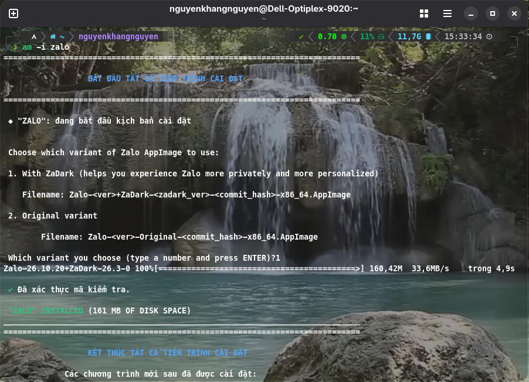

# Zalo for Linux 🐧

[English](./README.md) | **Tiếng Việt**

[](https://github.com/VN-Linux-Family/zalo-for-linux/actions/workflows/build.yml)

[](#contributors)

Bản port Zalo desktop không chính thức, do cộng đồng phát triển, **chỉ dành cho Linux**. Ứng dụng được đóng gói lại từ bản Zalo chính thức cho macOS thành một file AppImage tiêu chuẩn, có tích hợp sẵn ZaDark.

Cảm ơn **realdtn2** đã đưa ra giải pháp: [realdtn2/zalo-linux-2026](https://github.com/DMKha241/zalo-linux-2026) (repo gốc đã bị xóa/ẩn, chúng mình đang dùng một repo dự phòng từ [DMKha241](https://github.com/DMKha241)).

## ⚡ Bắt đầu nhanh

### 1. am

Cài đặt và cập nhật trực tiếp qua [am](https://github.com/ivan-hc/AM):

```bash
# Cài đặt Zalo
am -i zalo

# Cập nhật Zalo
am -u
```

<p align="center">
  
</p>

---

### 2. Nix

Kho lưu trữ cung cấp sẵn một Nix flake đã đóng gói AppImage cùng các phụ thuộc gọi điện:

**Cấu hình hệ thống NixOS (`flake.nix` + `configuration.nix`):**

```nix
# flake.nix
{
  inputs.zalo-for-linux = {
    url = "github:VN-Linux-Family/zalo-for-linux";
    inputs.nixpkgs.follows = "nixpkgs";
  };
  outputs = { nixpkgs, zalo-for-linux, ... }: {
    nixosConfigurations.<hostname> = nixpkgs.lib.nixosSystem {
      modules = [ zalo-for-linux.nixosModules.default ./configuration.nix ];
    };
  };
}
```

```nix
# configuration.nix
programs.zalo = {
  enable = true;
  # variant = "original"; # bỏ chú thích nếu muốn dùng bản gốc không kèm ZaDark
};
```

**Home Manager (`home.nix`):**

```nix
programs.zalo.enable = true;
```

**Chạy thử trực tiếp không cần cài đặt:**

```bash
nix run github:VN-Linux-Family/zalo-for-linux
```

### 3. Các cách cài đặt khác

<details>
<summary><b>⚙️ Gear Lever (Khuyên dùng để thêm vào Menu ứng dụng)</b></summary>

1. Tải file `.AppImage` từ mục [**Releases**](https://github.com/VN-Linux-Family/zalo-for-linux/releases).
2. Cài **Gear Lever** từ [Flathub](https://flathub.org/en/apps/it.mijorus.gearlever).
3. Mở Gear Lever $\rightarrow$ bấm **Open** $\rightarrow$ chọn file `.AppImage` đã tải.
4. Bấm **Move to the app menu** để đưa Zalo vào menu ứng dụng của máy tính.
5. Các bản cập nhật tiếp theo sẽ được Gear Lever tự động nhận diện và cập nhật qua nút **Update**.

</details>

<details>
<summary><b>📦 Chạy thủ công</b></summary>

Tải file `.AppImage` mới nhất từ mục [**Releases**](https://github.com/VN-Linux-Family/zalo-for-linux/releases), cấp quyền thực thi và khởi chạy:

```bash
chmod +x Zalo-*.AppImage
./Zalo-*.AppImage
```

> 📞 **Yêu cầu gọi thoại & video**: Cài đặt các gói âm thanh sau để sử dụng engine gọi native:
>
> - **Debian / Ubuntu**: `sudo apt install python3 libopus0 pulseaudio-utils`
> - **Arch Linux**: `sudo pacman -S python opus pulseaudio`
> - **Fedora / RHEL**: `sudo dnf install python3 opus pulseaudio-utils`

</details>

<details>
<summary><b>🛠️ Tự build từ mã nguồn</b></summary>

Yêu cầu: Node.js 22+, npm, `7z` (`p7zip-full`), bộ công cụ C++ và Rust.

```bash
git clone https://github.com/VN-Linux-Family/zalo-for-linux.git
cd zalo-for-linux
git submodule update --init --recursive
npm run main
```

File AppImage hoàn chỉnh sẽ được lưu trong thư mục `dist/`. Chi tiết về các biến môi trường và quy trình build nằm trong [development.vi.md](./docs/dev/development.vi.md).

</details>

---

## 📚 Danh mục tài liệu hướng dẫn

| Tài liệu                                                          | Mục đích                                                                    |
| :---------------------------------------------------------------- | :-------------------------------------------------------------------------- |
| [**Lỗi thường gặp & Cách xử lý**](./docs/user/known-issues.vi.md) | Bảng tra cứu lỗi nhanh, cờ sandbox Ubuntu, và khắc phục âm thanh cuộc gọi.  |
| [**Danh sách tính năng**](./docs/user/features.vi.md)             | Chế độ offline, khởi động ẩn khay hệ thống, userscript và giao diện ZaDark. |
| [**Kiến trúc hệ thống**](./docs/dev/architecture.vi.md)           | Tổng quan kỹ thuật về Electron shell, patch pipeline và native addons.      |
| [**Hướng dẫn phát triển**](./docs/dev/development.vi.md)          | Cài đặt môi trường code, build local và debug ứng dụng.                     |
| [**Hướng dẫn viết Patch**](./docs/dev/patch-guide.vi.md)          | Quy chuẩn viết, kiểm thử và duy trì các bản vá JavaScript.                  |
| [**Quy trình CI/CD & Release**](./docs/dev/ci-workflow.vi.md)     | Cơ chế thăm dò bản mới từ VNG, bot phát hành và cập nhật Nix hash.          |
| [**Hướng dẫn đóng góp**](./CONTRIBUTING.vi.md)                    | Tiêu chuẩn mở PR, commit convention và quy định kiểm thử.                   |

---

## ⚙️ Cách hoạt động

Dự án này không viết lại Zalo từ đầu. Cách làm như sau:

1. Tải file `.dmg` chính thức của Zalo cho macOS.
2. Dùng `7z` để giải nén file `app.asar`, nơi chứa phần logic chính của ứng dụng viết bằng JavaScript.
3. Loại bỏ các file native của macOS không tương thích.
4. Bọc ứng dụng đã giải nén trong một Electron shell tối giản, tương thích với Linux.
5. Dùng `electron-builder`, sau đó là `quick-sharun` để đóng gói tất cả thành một file `AppImage` duy nhất, chạy được trên nhiều bản phân phối Linux.

Tìm hiểu sâu hơn về build pipeline và cách patch trong [`architecture.md`](./docs/dev/architecture.md).

Về các native addon (db-cross-v4, v.v.), xem [`nativelibs/README.md`](./nativelibs/README.md).

Về engine gọi điện native, xem [`zcall-native/README.md`](./zcall-native/README.md).

## 🐛 Xử lý sự cố và gỡ lỗi

Nếu gặp lỗi hoặc muốn xem ứng dụng đang hoạt động thế nào, bạn có thể mở Chrome Developer Tools (DevTools) bằng một trong hai cách:

- **Phím tắt**: nhấn `Ctrl` + `Shift` + `I` khi đang ở cửa sổ Zalo.
- **Menu ở khay hệ thống**: nhấp chuột phải vào biểu tượng Zalo ở khay hệ thống và chọn **"Toggle DevTools"**.

## Những người đóng góp

Cảm ơn những con người tuyệt vời

<!-- ALL-CONTRIBUTORS-LIST:START - Do not remove or modify this section -->
<!-- prettier-ignore-start -->
<!-- markdownlint-disable -->
<table>
  <tbody>
    <tr>
      <td align="center" valign="top" width="14.28%"><a href="https://github.com/doandat943"><br /><sub><b>DANG DOAN DAT</b></sub></a><br /><a href="https://github.com/VN-Linux-Family/zalo-for-linux/commits?author=doandat943" title="Code">💻</a> <a href="https://github.com/VN-Linux-Family/zalo-for-linux/commits?author=doandat943" title="Documentation">📖</a> <a href="#infra-doandat943" title="Infrastructure (Hosting, Build-Tools, etc)">🚇</a> <a href="#projectManagement-doandat943" title="Project Management">📆</a> <a href="https://github.com/VN-Linux-Family/zalo-for-linux/pulls?q=is%3Apr+reviewed-by%3Adoandat943" title="Reviewed Pull Requests">👀</a></td>
      <td align="center" valign="top" width="14.28%"><a href="https://github.com/nhktmdzhg"><br /><sub><b>Nguyen Hoang Ky</b></sub></a><br /><a href="https://github.com/VN-Linux-Family/zalo-for-linux/commits?author=nhktmdzhg" title="Code">💻</a> <a href="https://github.com/VN-Linux-Family/zalo-for-linux/commits?author=nhktmdzhg" title="Documentation">📖</a> <a href="#infra-nhktmdzhg" title="Infrastructure (Hosting, Build-Tools, etc)">🚇</a> <a href="#maintenance-nhktmdzhg" title="Maintenance">🚧</a> <a href="#blog-nhktmdzhg" title="Blogposts">📝</a> <a href="https://github.com/VN-Linux-Family/zalo-for-linux/pulls?q=is%3Apr+reviewed-by%3Anhktmdzhg" title="Reviewed Pull Requests">👀</a></td>
      <td align="center" valign="top" width="14.28%"><a href="https://github.com/DMKha241"><br /><sub><b>DMKha</b></sub></a><br /><a href="https://github.com/VN-Linux-Family/zalo-for-linux/commits?author=DMKha241" title="Code">💻</a> <a href="#infra-DMKha241" title="Infrastructure (Hosting, Build-Tools, etc)">🚇</a></td>
      <td align="center" valign="top" width="14.28%"><a href="https://truong.me/"><br /><sub><b>truong.me</b></sub></a><br /><a href="https://github.com/VN-Linux-Family/zalo-for-linux/commits?author=nct88" title="Code">💻</a> <a href="https://github.com/VN-Linux-Family/zalo-for-linux/commits?author=nct88" title="Documentation">📖</a></td>
      <td align="center" valign="top" width="14.28%"><a href="https://github.com/imngkhang"><br /><sub><b>imngkhang</b></sub></a><br /><a href="https://github.com/VN-Linux-Family/zalo-for-linux/commits?author=imngkhang" title="Code">💻</a> <a href="https://github.com/VN-Linux-Family/zalo-for-linux/commits?author=imngkhang" title="Documentation">📖</a> <a href="#infra-imngkhang" title="Infrastructure (Hosting, Build-Tools, etc)">🚇</a></td>
      <td align="center" valign="top" width="14.28%"><a href="https://ngxccc.github.io/"><br /><sub><b>Ngoc Tran</b></sub></a><br /><a href="https://github.com/VN-Linux-Family/zalo-for-linux/commits?author=ngxccc" title="Code">💻</a> <a href="https://github.com/VN-Linux-Family/zalo-for-linux/commits?author=ngxccc" title="Tests">⚠️</a> <a href="#infra-ngxccc" title="Infrastructure (Hosting, Build-Tools, etc)">🚇</a></td>
      <td align="center" valign="top" width="14.28%"><a href="https://github.com/akimiya7742"><br /><sub><b>Akimiya</b></sub></a><br /><a href="https://github.com/VN-Linux-Family/zalo-for-linux/commits?author=akimiya7742" title="Code">💻</a></td>
    </tr>
    <tr>
      <td align="center" valign="top" width="14.28%"><a href="https://orbisappsec.com/"><br /><sub><b>Anupam Mediratta</b></sub></a><br /><a href="https://github.com/VN-Linux-Family/zalo-for-linux/commits?author=anupamme" title="Code">💻</a> <a href="#security-anupamme" title="Security">🛡️</a></td>
      <td align="center" valign="top" width="14.28%"><a href="https://github.com/justanoobcoder"><br /><sub><b>Nguyễn Hồng Hiệp</b></sub></a><br /><a href="https://github.com/VN-Linux-Family/zalo-for-linux/commits?author=justanoobcoder" title="Code">💻</a> <a href="#infra-justanoobcoder" title="Infrastructure (Hosting, Build-Tools, etc)">🚇</a></td>
      <td align="center" valign="top" width="14.28%"><a href="https://retec.vn/"><br /><sub><b>namtao</b></sub></a><br /><a href="https://github.com/VN-Linux-Family/zalo-for-linux/commits?author=namtao" title="Code">💻</a> <a href="https://github.com/VN-Linux-Family/zalo-for-linux/commits?author=namtao" title="Documentation">📖</a></td>
      <td align="center" valign="top" width="14.28%"><a href="https://github.com/mncc8337"><br /><sub><b>mncc</b></sub></a><br /><a href="https://github.com/VN-Linux-Family/zalo-for-linux/commits?author=mncc8337" title="Code">💻</a> <a href="#infra-mncc8337" title="Infrastructure (Hosting, Build-Tools, etc)">🚇</a></td>
      <td align="center" valign="top" width="14.28%"><a href="https://github.com/hainguyents13"><br /><sub><b>Hải Nguyễn</b></sub></a><br /><a href="https://github.com/VN-Linux-Family/zalo-for-linux/commits?author=hainguyents13" title="Documentation">📖</a> <a href="#translation-hainguyents13" title="Translation">🌍</a></td>
      <td align="center" valign="top" width="14.28%"><a href="https://github.com/dont-wait"><br /><sub><b>sang-nt</b></sub></a><br /><a href="https://github.com/VN-Linux-Family/zalo-for-linux/commits?author=dont-wait" title="Code">💻</a> <a href="https://github.com/VN-Linux-Family/zalo-for-linux/commits?author=dont-wait" title="Documentation">📖</a></td>
      <td align="center" valign="top" width="14.28%"><a href="https://github.com/NguyenDuc2309"><br /><sub><b>Nguyễn Đức</b></sub></a><br /><a href="https://github.com/VN-Linux-Family/zalo-for-linux/commits?author=NguyenDuc2309" title="Code">💻</a></td>
    </tr>
    <tr>
      <td align="center" valign="top" width="14.28%"><a href="https://github.com/collyn"><br /><sub><b>Nguyen Tien Huy</b></sub></a><br /><a href="https://github.com/VN-Linux-Family/zalo-for-linux/commits?author=collyn" title="Code">💻</a></td>
      <td align="center" valign="top" width="14.28%"><a href="https://github.com/hthienloc"><br /><sub><b>Huỳnh Thiện Lộc</b></sub></a><br /><a href="https://github.com/VN-Linux-Family/zalo-for-linux/commits?author=hthienloc" title="Documentation">📖</a></td>
      <td align="center" valign="top" width="14.28%"><a href="https://github.com/brucenguyen1102"><br /><sub><b>Bruce Nguyen</b></sub></a><br /><a href="https://github.com/VN-Linux-Family/zalo-for-linux/commits?author=brucenguyen1102" title="Code">💻</a></td>
      <td align="center" valign="top" width="14.28%"><a href="https://github.com/lolmc0587"><br /><sub><b>Tom</b></sub></a><br /><a href="https://github.com/VN-Linux-Family/zalo-for-linux/commits?author=lolmc0587" title="Code">💻</a></td>
      <td align="center" valign="top" width="14.28%"><a href="https://github.com/mrd9999"><br /><sub><b>MrD</b></sub></a><br /><a href="#promotion-mrd9999" title="Promotion">📣</a> <a href="#maintenance-mrd9999" title="Maintenance">🚧</a></td>
    </tr>
  </tbody>
</table>

<!-- markdownlint-restore -->
<!-- prettier-ignore-end -->

<!-- ALL-CONTRIBUTORS-LIST:END -->

## 📄 Giấy phép & Miễn trừ

### Giấy phép

Dự án này được phát hành theo giấy phép BSD 3-Clause "Mới" hoặc "Sửa đổi".

### Miễn trừ

Dự án này là bản port không chính thức và không liên kết với, không được xác nhận bởi, hoặc được bảo trợ bởi Zalo hay Tập đoàn VNG.

Zalo là thương hiệu của Tập đoàn VNG. Phần mềm này chỉ được cung cấp cho mục đích giáo dục và sử dụng cá nhân. Người dùng có trách nhiệm tuân thủ các điều khoản dịch vụ và pháp luật hiện hành.

Dự án này **không bảo trợ, xác minh hoặc chịu trách nhiệm** cho bất kỳ bản fork nào từ bên thứ ba HOẶC các bản fork yêu cầu quyên góp; bất kỳ phiên bản chỉnh sửa hoặc bản fork nào chứa mã độc hoạt động hoàn toàn độc lập và không có sự ủy quyền của chúng mình, theo Điều khoản 3 của giấy phép BSD 3-Clause.
