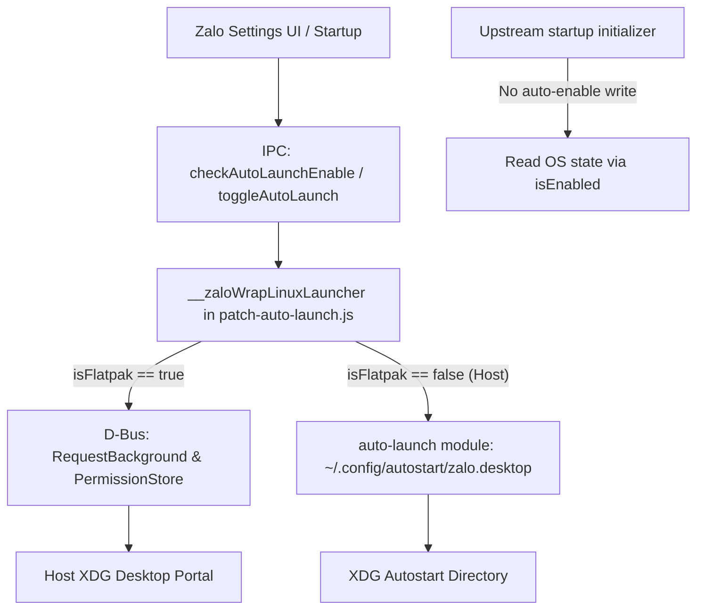
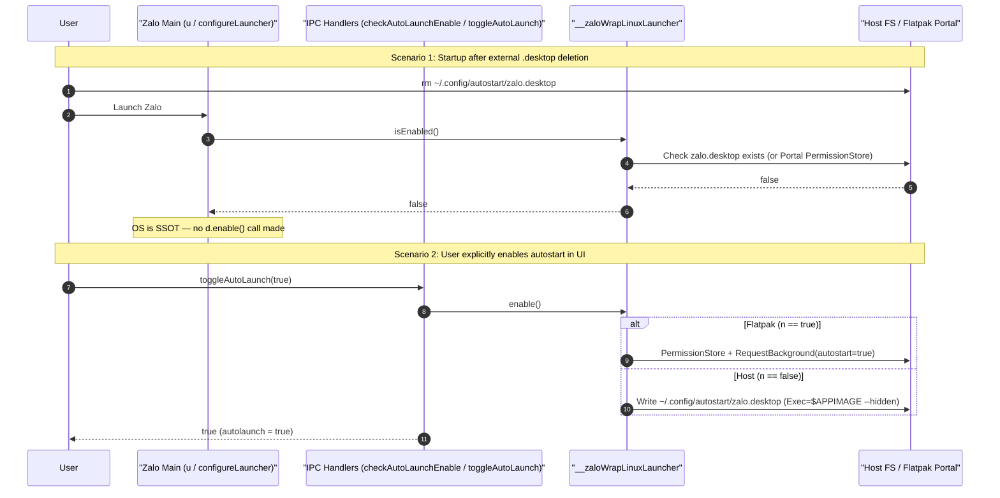

# Linux Autostart OS SSOT & Environment-Scoped Launcher

## Overview & Context

### Executive Summary

This design resolves [Issue #229](https://github.com/VN-Linux-Family/zalo-for-linux/issues/229) by aligning Zalo's Linux autostart lifecycle in `scripts/patches/patch-auto-launch.js` with XDG Autostart semantics and Flatpak portal boundaries:

1. **OS State as Single Source of Truth (SSOT)**: Eliminate upstream's startup auto-recreation (`!1 !== e.get("autolaunch")` triggering `d.enable()` when `isEnabled()` is `false`). Autostart is opt-in on Linux and only mutated when the user explicitly toggles the setting in `toggleAutoLaunch`.
2. **Environment-Scoped Launcher**: Route Flatpak builds exclusively through `org.freedesktop.portal.Background` / `PermissionStore`, and route host builds (AppImage, `.deb`, Nix, tarball) exclusively through XDG `~/.config/autostart/zalo.desktop`.
3. **Canonical Entry Name**: Set `e.name = "zalo"` on Linux so host autostart always targets `~/.config/autostart/zalo.desktop` rather than `<basename(APPIMAGE)>.desktop`.

### Premise Gate Findings

- **Rejected Premise**: Issue #229 assumed the bug occurred because `r.enable()` ran after `org.freedesktop.portal.Background.RequestBackground` threw `UnknownMethod`. Suppressing the `.desktop` fallback when the portal is unavailable would break autostart on all wlroots/minimal Wayland compositors (`xdg-desktop-portal-wlr`, `xdg-desktop-portal-umbriel`) and X11 environments without a Background portal.
- **Root Cause**: Upstream `app/main-dist/main.js` defaults `autolaunch` to `true` (`!1 !== e.get("autolaunch")`) and calls `d.enable()` on every startup whenever `d.isEnabled()` returns `false`. Deleting `~/.config/autostart/*.desktop` externally leaves `appConfig` unchanged, causing Zalo to recreate the file on next launch.
- **Secondary Defects**: `__zaloWrapLinuxLauncher.enable()` invoked `r.enable()` unconditionally even when Portal succeeded; `e.name` was unset (producing `Zalo.AppImage.desktop` instead of `zalo.desktop`); and `gdbus call ... RequestBackground` on non-Flatpak hosts cannot detect silent rejections returned asynchronously via `org.freedesktop.portal.Request::Response`.

### Goals

- Deleting `~/.config/autostart/zalo.desktop` (or disabling via DE settings) persists across Zalo restarts.
- Fresh Linux installs do not register autostart without explicit user opt-in.
- Zero duplicate `.desktop` entries between Portal and `auto-launch`.
- Consistent `~/.config/autostart/zalo.desktop` filename regardless of AppImage path or filename.
- Idempotent patching across `app/main-dist/main.js` and `app/main-dist/compact-app.js`.

### Non-Goals

- Implementing a full `gdbus` signal listener for `org.freedesktop.portal.Request::Response` on non-Flatpak hosts.
- Modifying Windows (`win32`) or macOS (`darwin`) autostart behavior.

---

## Architecture

### Key Component Changes (`scripts/patches/patch-auto-launch.js`)

- **`DBUS_LAUNCHER_HELPER` (`__zaloWrapLinuxLauncher`)**:
  - `isEnabled()`: If `n` (Flatpak), query `PermissionStore.GetPermission`; otherwise delegate to `r.isEnabled()`.
  - `enable()`: If `n` (Flatpak), call `PermissionStore.SetPermission` (`['yes']`) and `RequestBackground` (`autostart: true`), throwing if Portal fails. If `!n` (Host), call `r.enable()` directly without invoking Portal.
  - `disable()`: If `n` (Flatpak), call `RequestBackground` (`autostart: false`) and `PermissionStore.SetPermission` (`['no']`). If `!n` (Host), call `r.disable()`, and best-effort remove legacy `basename(APPIMAGE).desktop` if it exists alongside `zalo.desktop`.
- **Launcher Options (`LAUNCHER_OPTIONS_PATCHED`, `COMPACT_LAUNCHER_OPTIONS_PATCHED`, and AST path)**:
  - On `linux`, set `e.name = "zalo"`, `e.path = process.env.APPIMAGE || i.getPath("exe")`, `e.isHidden = !0`.
- **Startup Sync Patch (`app/main-dist/main.js` & `app/main-dist/compact-app.js`)**:
  - Patch upstream `configureLauncher` startup sync so `d.isEnabled()` is never used to auto-call `d.enable()` when the OS entry is absent (only sync `appConfig` or log state without mutating OS autostart).

---

## Operational Flow

### State Transitions

| Initial OS State | `appConfig.autolaunch` | Trigger | Resulting OS State | Resulting `appConfig.autolaunch` |
| :--- | :--- | :--- | :--- | :--- |
| Absent | `undefined` (fresh install) | App startup | Absent | `false` / `undefined` (no write) |
| Enabled (`zalo.desktop`) | `true` | User deletes `.desktop` externally + restart | Absent | Synced to `false` (no recreation) |
| Absent | `false` | User toggles ON in Settings | Enabled (`zalo.desktop` or Portal) | `true` |
| Enabled | `true` | User toggles OFF in Settings | Absent (`zalo.desktop` + legacy removed, or Portal `false`) | `false` |

---

## Security & Reliability

- **Least Privilege & Sandbox Boundary**: Flatpak builds never attempt host filesystem writes via `auto-launch` and rely strictly on `org.freedesktop.portal.Background` and `PermissionStore`.
- **Command Injection / Exec Safety**: `e.path` uses `process.env.APPIMAGE || app.getPath("exe")` and `e.name` is hardcoded to `"zalo"`, preventing arbitrary `.desktop` filenames from user-renamed binaries.
- **Fail-Safe Degradation**:
  - On host, `disable()` treats missing `zalo.desktop` or missing legacy `Zalo.AppImage.desktop` as idempotent success (`ENOENT` ignored).
  - On Flatpak, `enable()` propagates D-Bus errors to `HANDLERS_PATCHED` (`linux_auto_launch_error`) so the UI accurately reflects failure instead of silently pretending autostart succeeded.
- **Edge Cases**:
  - **AppImage Rename / Upgrade**: Because `e.name = "zalo"`, `Exec=` updates to the new `APPIMAGE` path on toggle without creating a second `.desktop` file.
  - **Legacy Cleanup**: If `Zalo.AppImage.desktop` exists from a prior version, `disable()` cleans it up alongside `zalo.desktop`.

---

## Domain Invariant Taxonomy

| ID | Invariant | Verification Target |
| :--- | :--- | :--- |
| `INV-1` | Startup initialization MUST NOT call `enable()` or create `~/.config/autostart/*.desktop` when the OS autostart entry is absent. | Unit test on patched `main.js` / `compact-app.js` startup sync |
| `INV-2` | When `FLATPAK_ID` or `/.flatpak-info` is present (`n === true`), `enable()` and `disable()` MUST NOT invoke `r.enable()` / `r.disable()`. | Unit test mocking `fs.existsSync` / `env.FLATPAK_ID` & `child_process.execFile` |
| `INV-3` | When running on host (`n === false`), `enable()` and `disable()` MUST NOT invoke `gdbus` `RequestBackground` and MUST target `zalo.desktop` (`e.name === "zalo"`). | Unit test asserting `execFile("gdbus", ...)` is not called on host and `e.name === "zalo"` |
| `INV-4` | `patchAutoLaunch(content)` MUST remain idempotent on both `main.js` and `compact-app.js`. | `tests/scripts-patches.test.js` / dedicated `patch-auto-launch` test |
