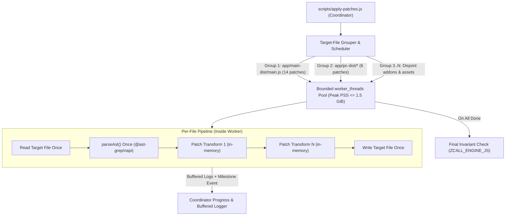
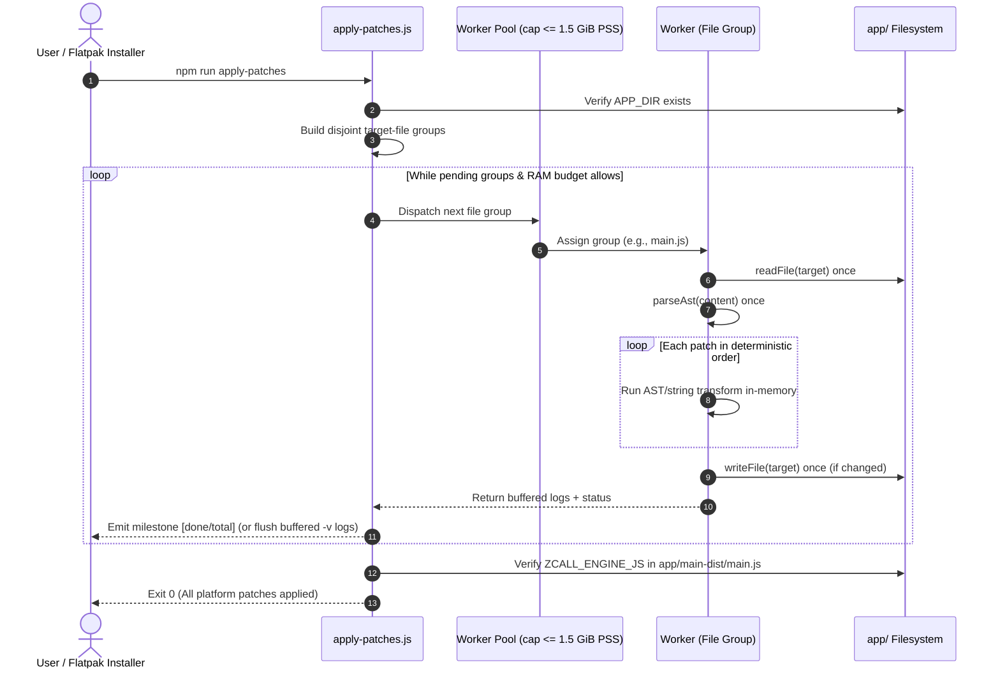

# Shared-File AST Patch Pipeline & Bounded Parallelism

## Overview & Context

### Executive Summary

This design resolves [Issue #222](https://github.com/VN-Linux-Family/zalo-for-linux/issues/222) by replacing the sequential per-patch file read/parse/write loop in `scripts/apply-patches.js` with a **two-stage optimization**:
1. **AST Query Optimization & Single-Parse Shared-File Pipeline**: Eliminate redundant `@ast-grep/napi` full-bundle parses on shared targets (e.g., `app/main-dist/main.js` and `app/pc-dist/compact-app-pc.*.js`) and remove full-tree literal scans such as `root.findAll('!1')` in `scripts/patches/patch-zcall-callgate.js`.
2. **Bounded Disjoint-File Parallelism & Flatpak Progress UX**: Execute disjoint target-file groups concurrently via a memory-bounded `worker_threads` pool (if post-optimization runtime remains above 15s) while reporting clean milestone progress in non-verbose Flatpak installs.

### Premise Gate Findings (Why Naive Parallelism Was Rejected)

- `scripts/apply-patches.js` does not use `execSync`; it `await`s patch modules sequentially in one Node.js process.
- Running patches unordered and writing concurrently to `app/` causes **silent lost updates**: 14 patches read/mutate/write `app/main-dist/main.js`, and 6 patches read/mutate/write `app/pc-dist/` bundles.
- In the Issue #222 benchmark (`226,114 ms` total), two AST-heavy tasks accounted for `77.7%` of wall time (`123.3s` / `1,476.89 MiB` RSS and `52.3s` / `1,428.80 MiB` RSS). Unbounded parallelism hits Amdahl's Law at `~123s` and risks OOM-killing `4–8 GiB` user machines or Flatpak sandboxes.

### Goals

- **Preserve AST Resilience**: Keep `@ast-grep/napi` (`parseAst` / `applyEdits` in `scripts/utils/ast-transform.js`) so patches survive Zalo minified identifier renames across updates.
- **Zero Lost Updates**: Guarantee serialized in-memory transformation per target file.
- **Bounded Memory**: Enforce `Peak PSS <= 1.5 GiB` during `apply-patches` execution on user machines.
- **Flatpak Non-Verbose UX**: Emit clean milestone progress lines (`[done/total]`) without interleaved worker logs.
- **Dual-Mode Backward Compatibility**: Keep standalone `node scripts/patches/<name>.js` execution and `tests/scripts-decouple-pipeline.test.js` contracts intact.

### Non-Goals

- Downgrading AST patches to fragile regex/string replacements where minified variable names vary.
- Full `app/` directory staging copies (doubles disk footprint and I/O in Flatpak).
- Designing against non-`main` branches; baseline must be re-measured on current `main` via `benchmarks/bench-patches-real.js`.

---

## Architecture

### Key Architectural Decisions

1. **Dual-Mode Patch Contract (`scripts/patches/*.js`)**:
   - Each patch module retains its standalone `main()` entry point (`if (require.main === module)`) for debugging and `npm run bench:patches`.
   - Patches targeting shared JS bundles expose declarative target descriptors and pure `transform(context)` functions operating on shared `{ content, ast }` state, avoiding repeated disk I/O and `parseAst()` calls.
2. **AST Query Optimization First**:
   - Replace `root.findAll('!1')` scans in `scripts/patches/patch-zcall-callgate.js` with scoped structural patterns (`enableCall: !1`, `enableVideoCall: !1`) before introducing worker threads.
   - Re-benchmark `benchmarks/bench-patches-real.js` on `main`. Use single-process async I/O if optimized total runtime is `< 15s`; otherwise enable `worker_threads` capped at `2–3` concurrent workers to stay within `Peak PSS <= 1.5 GiB`.

---

## Operational Flow

### Failure & State Transition Rules

- **Pending → Running → Completed**: Dispatched only when active worker count is below the memory-derived concurrency cap.
- **Running → Failed (Fail-Fast)**: If any patch throws an error, the coordinator stops dispatching pending groups, flushes the failing worker's buffered stderr, and exits non-zero.
- **Recovery**: Because every patch is strictly idempotent, re-running `apply-patches` after fixing the cause safely converges `app/` without requiring a fresh `npm run extract`.

---

## Security & Reliability

- **Concurrency & Data Integrity**: Disjoint file partitioning guarantees at most one worker ever reads or writes any given file path at a time.
- **Memory & OOM Protection**: Concurrency is bounded by `min(os.cpus().length, maxWorkersByMemory)` targeting `Peak PSS <= 1.5 GiB` (maximum `2–3` concurrent large-bundle AST parses).
- **Observability & Log Isolation**: Workers buffer all `logger` messages in memory and send them to the coordinator upon completion, preventing interleaved stdout in `-v` mode and keeping non-verbose Flatpak output to clean `[done/total]` milestone lines.
- **Fail-Safe Verification**: The post-patch check in `scripts/apply-patches.js` (`ZCALL_ENGINE_JS` presence in `app/main-dist/main.js`) remains mandatory before returning exit code `0`.

---

## Domain Invariant Taxonomy

| ID | Invariant | Enforcement Mechanism | Verification Mapping |
| :--- | :--- | :--- | :--- |
| **INV-1** | **Single-Writer Per File**: No two concurrent tasks may read-modify-write the same target file path | Target-file grouping in `scripts/apply-patches.js` | Unit test verifying disjoint group paths across all registered patches |
| **INV-2** | **Bounded/Minimal AST Parsing**: A shared JS bundle is either parsed once (`runFileGroup` `astSteps`) or parsed only on minimal balanced snippets (`extractBlockFrom`/`extractEnclosingBlock`), and skipped completely when already patched | `runFileGroup` single-parse + `isAlreadyPatched` fast-skip + Snippet AST | Spy/counter test on `parseAst` and `runFileGroup` in `tests/patch-pipeline.test.js` |
| **INV-3** | **Strict Idempotency**: Running `apply-patches` twice on the same `APP_DIR` produces identical files and exit code `0` | Idempotency guards in every patch transform | Integration test running `applyPatchesMain()` twice consecutively |
| **INV-4** | **Memory Ceiling**: Total process tree `Peak PSS` must not exceed `1.5 GiB` | Bounded worker pool concurrency cap | `benchmarks/bench-patches-real.js` PSS sampling |
| **INV-5** | **AST Resilience Preserved**: Minified identifier-independent patches continue using `@ast-grep/napi` | Keep `parseAst`/`applyEdits` for structural matches | Existing patch unit tests + `tests/scripts-decouple-pipeline.test.js` |
| **INV-6** | **Deterministic Output & Fail-Fast**: Patch order within each file group is fixed; any patch failure aborts remaining dispatches with non-zero exit | Ordered transform array per group + coordinator abort on worker error | Fault-injection test in `apply-patches` test suite |
