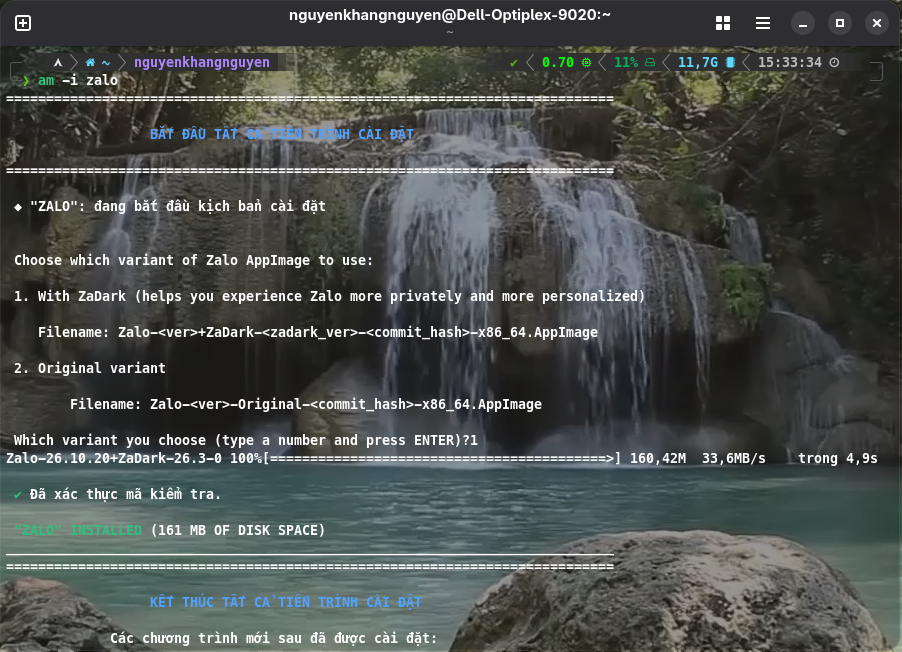

# Zalo for Linux 🐧

[English](../README.md) | **Tiếng Việt**

[](https://github.com/VN-Linux-Family/zalo-for-linux/actions/workflows/build.yml)

Bản port Zalo desktop không chính thức, do cộng đồng phát triển, **chỉ dành cho Linux**. Ứng dụng được đóng gói lại từ bản Zalo chính thức cho macOS thành một file AppImage tiêu chuẩn, có tích hợp sẵn ZaDark.

Cảm ơn **realdtn2** đã đưa ra giải pháp: [realdtn2/zalo-linux-2026](https://github.com/DMKha241/zalo-linux-2026) (repo gốc đã bị xóa/ẩn, chúng mình đang dùng một repo dự phòng từ [DMKha241](https://github.com/DMKha241)).

## ⚠️ Lưu ý quan trọng: Các lỗi đã biết

> 💡 **Danh sách đầy đủ các lỗi đã sửa, cách khắc phục tạm thời và ghi nhận đóng góp của cộng đồng nằm trong [KNOWN_ISSUES.vi.md](./KNOWN_ISSUES.vi.md).**

Dự án này phù hợp nhất với những ai cần một ứng dụng Zalo chạy như ứng dụng gốc trên Linux và không ngại xử lý một vài thao tác kỹ thuật để dùng đầy đủ tính năng.

## ✨ Tính năng bổ sung

Dự án có thêm một số tính năng mà bản Zalo chính thức không có.

✨ **Danh sách đầy đủ các tính năng có trong dự án nằm trong [FEATURES.vi.md](./FEATURES.vi.md).**

## 🚀 Bắt đầu nhanh

### Cài đặt và sử dụng

Chúng mình khuyên bạn nên dùng **Gear Lever** hoặc **AM** để AppImage được tích hợp gọn gàng vào menu ứng dụng của hệ thống.

**Lưu ý:** Zalo for Linux đã có sẵn thông tin cập nhật bên trong, bạn không cần tự cấu hình gì thêm để cập nhật ứng dụng.

#### Nếu bạn dùng AM

*Lưu ý: nếu bạn chọn cài `appman` thì thay `am` bằng `appman` trong tất cả các dòng chứa chuỗi này.*

1. Cài **AM** theo [hướng dẫn của AM](https://github.com/ivan-hc/AM#using-the-am-installer-script-to-choose-between-local-and-system-wide-installation).
2. Chạy lệnh sau để cài Zalo:
   ```bash
   am -i zalo
   ```
3. Một lời nhắc như hình dưới sẽ hiện ra:
   

   *Bạn chọn phiên bản mình muốn, AM sẽ tự tải đúng phiên bản.*
4. Vậy là ứng dụng **đã được cài**. Bạn có thể mở Zalo từ menu ứng dụng của hệ thống.

   Hoặc chạy từ dòng lệnh (terminal):
   ```bash
   zalo
   ```
5. Cách cập nhật:
   Chỉ cần chạy lệnh dưới đây, AM sẽ **tự động cập nhật mọi ứng dụng đã cài qua AM (bao gồm Zalo)**:
   ```bash
   am -u
   ```
   *Mẹo: Bạn nên cài đặt `appimageupdatetool` từ AM bằng cách chạy lệnh `am -i appimageupdatetool` để cập nhật các ứng dụng nhanh hơn. Phiên bản đầu tiên (cái có số là 1) được khuyến nghị hơn phiên bản thứ hai (có số là 2).*

#### Nếu bạn dùng Gear Lever

1. Tải file `.AppImage` mới nhất ở trang [**Releases**](https://github.com/VN-Linux-Family/zalo-for-linux/releases).
2. Cài **Gear Lever** từ [Flathub](https://flathub.org/en/apps/it.mijorus.gearlever).
3. Mở **Gear Lever**.
4. Bấm nút **"Open"** ở góc trên bên trái rồi chọn file `.AppImage` vừa tải.
5. Ứng dụng sẽ hiện trong Gear Lever. Bấm nút **"Unlock"**, sau đó chọn **"Move to the app menu"** để đưa Zalo vào menu ứng dụng của hệ thống.
6. Cách cập nhật:
   - Mở **Gear Lever**.
   - Khi có bản cập nhật, nút **No updates available** sẽ chuyển thành **Update**. Bạn chỉ cần bấm vào là Zalo được cập nhật.

#### Nếu bạn dùng NixOS

Repo này là một flake, cài Zalo từ file AppImage của bản phát hành, kèm sẵn những thứ cần cho cuộc gọi (`python3`, libopus, bộ công cụ PulseAudio).

1. Thêm flake vào `flake.nix` của hệ thống và import module của nó:
   ```nix
   {
     inputs.zalo-for-linux = {
       url = "github:VN-Linux-Family/zalo-for-linux";
       inputs.nixpkgs.follows = "nixpkgs";
     };

     outputs = { nixpkgs, zalo-for-linux, ... }: {
       nixosConfigurations.<hostname> = nixpkgs.lib.nixosSystem {
         modules = [
           zalo-for-linux.nixosModules.default
           ./configuration.nix
         ];
       };
     };
   }
   ```
2. Bật Zalo trong `configuration.nix`:
   ```nix
   programs.zalo = {
     enable = true;
     # variant = "original";  # bản AppImage không có ZaDark
   };
   ```
   Cuộc gọi cần âm thanh qua PipeWire (`services.pipewire.pulse.enable = true;`) hoặc PulseAudio.
3. Áp dụng bằng lệnh `sudo nixos-rebuild switch`.
4. Cách cập nhật:
   ```bash
   nix flake update zalo-for-linux
   sudo nixos-rebuild switch
   ```
   *Lưu ý: mỗi lần build lại, file AppImage cũ trên trang Releases bị xoá. Nếu `nixos-rebuild` báo lỗi tải file (404), hãy chạy `nix flake update zalo-for-linux` để flake trỏ sang bản mới nhất rồi rebuild lại.*

#### Nếu bạn dùng Home Manager

Flake cũng có module cho Home Manager với các option `programs.zalo` giống hệt, cài Zalo cho riêng người dùng của bạn (trên NixOS hay distro nào cũng được).

1. Thêm flake vào `flake.nix` và import module của nó:
   ```nix
   {
     inputs.zalo-for-linux = {
       url = "github:VN-Linux-Family/zalo-for-linux";
       inputs.nixpkgs.follows = "nixpkgs";
     };

     outputs = { nixpkgs, home-manager, zalo-for-linux, ... }: {
       homeConfigurations.<username> = home-manager.lib.homeManagerConfiguration {
         pkgs = nixpkgs.legacyPackages.x86_64-linux;
         modules = [
           zalo-for-linux.homeModules.default
           ./home.nix
         ];
       };
     };
   }
   ```
   Nếu bạn dùng Home Manager dưới dạng module của NixOS, hãy thêm `zalo-for-linux.homeModules.default` vào `home-manager.sharedModules` (hoặc vào `imports` trong config người dùng).
2. Bật Zalo trong `home.nix`:
   ```nix
   programs.zalo = {
     enable = true;
     # variant = "original";  # bản AppImage không có ZaDark
   };
   ```
3. Áp dụng bằng lệnh `home-manager switch` (hoặc `sudo nixos-rebuild switch` nếu Home Manager là module của NixOS).
4. Cách cập nhật:
   ```bash
   nix flake update zalo-for-linux
   home-manager switch
   ```

Muốn chạy thử mà không cài: `nix run github:VN-Linux-Family/zalo-for-linux`.

#### Chạy thủ công (không khuyến khích)

1. Tải file `.AppImage` mới nhất ở trang [**Releases**](https://github.com/VN-Linux-Family/zalo-for-linux/releases).
2. Cấp quyền thực thi cho file:
   ```bash
   chmod +x <tên-file-đã-tải> # Xem tên file bằng lệnh ls, hoặc dùng trình quản lý file
   ```
3. Chạy ứng dụng bằng lệnh:
   ```bash
   ./<tên-file-đã-tải>
   ```
4. Để cập nhật, bạn chỉ cần **tải lại file `.AppImage` mới nhất** ở trang **Releases**, rồi **làm lại bước 2 và 3**.

*LƯU Ý: Sau khi cập nhật, hãy thoát hẳn ứng dụng rồi mở lại để thay đổi mới được áp dụng.*

### Tự build từ mã nguồn

Yêu cầu:

- Linux x86_64 hoặc aarch64
- Node.js và npm
- 7z (p7zip-full) để giải nén ứng dụng macOS trong bước setup
- C++ build tools (cho các native addon): `build-essential`, `libssl-dev`, `liblzma-dev`
- Rust toolchain, `clang`, `libclang-dev`, `llvm` (cho các native addon viết bằng Rust)
- Để gọi điện bằng bản đã build: `python3`, `libopus0`, `pulseaudio-utils` (không cần biên dịch gì, không Wine)

Trên Debian/Ubuntu:

```bash
sudo apt update && sudo apt install -y build-essential liblzma-dev p7zip-full gcc g++ clang libclang-dev llvm libx11-dev libxcb1-dev libxext-dev zsync
```

Các bước:

```bash
# Clone repository
git clone https://github.com/VN-Linux-Family/zalo-for-linux.git
cd zalo-for-linux
# Khởi tạo hoặc cập nhật submodule
git submodule update --init --recursive

# Chạy setup + build (tải DMG, giải nén, patch, đóng gói)
npm run main
```

File AppImage hoàn chỉnh sẽ nằm trong thư mục `dist/`.

> Hướng dẫn chi tiết về build pipeline, các script, biến môi trường và cách thêm patch mới nằm trong [`DEVELOPMENT.vi.md`](./DEVELOPMENT.vi.md).

## ⚙️ Cách hoạt động

Dự án này không viết lại Zalo từ đầu. Cách làm như sau:

1. Tải file `.dmg` chính thức của Zalo cho macOS.
2. Dùng `7z` để giải nén file `app.asar`, nơi chứa phần logic chính của ứng dụng viết bằng JavaScript.
3. Loại bỏ các file native của macOS không tương thích.
4. Bọc ứng dụng đã giải nén trong một Electron shell tối giản, tương thích với Linux.
5. Dùng `electron-builder`, sau đó là `quick-sharun` để đóng gói tất cả thành một file `AppImage` duy nhất, chạy được trên nhiều bản phân phối Linux.

Tìm hiểu sâu hơn về build pipeline và cách patch trong [`ARCHITECTURE.vi.md`](./ARCHITECTURE.vi.md).

Về các native addon (db-cross-v4, v.v.), xem [`nativelibs.vi.md`](./nativelibs.vi.md).

Về engine gọi điện native, xem [`zcall-native/README.md`](../zcall-native/README.md).

## 🐛 Xử lý sự cố và gỡ lỗi

Nếu gặp lỗi hoặc muốn xem ứng dụng đang hoạt động thế nào, bạn có thể mở Chrome Developer Tools (DevTools) bằng một trong hai cách:
- **Phím tắt**: nhấn `Ctrl` + `Shift` + `I` khi đang ở cửa sổ Zalo.
- **Menu ở khay hệ thống**: nhấp chuột phải vào biểu tượng Zalo ở khay hệ thống và chọn **"Toggle DevTools"**.

## 📚 Tài liệu khác

- [KNOWN_ISSUES.vi.md](./KNOWN_ISSUES.vi.md): các lỗi đã biết, cách khắc phục tạm thời và lịch sử các lỗi đã sửa
- [ARCHITECTURE.vi.md](./ARCHITECTURE.vi.md): cách build pipeline và các patch hoạt động
- [DEVELOPMENT.vi.md](./DEVELOPMENT.vi.md): build từ mã nguồn, các script, cách thêm patch
- [nativelibs.vi.md](./nativelibs.vi.md): các native addon (db-cross-v4, v.v.)
- [zcall-native/README.md](../zcall-native/README.md): engine gọi điện native

## 📄 Giấy phép & Miễn trừ

### Giấy phép

Dự án này được phát hành theo giấy phép BSD 3-Clause.

### Miễn trừ

Dự án này là bản port không chính thức và không liên kết với, không được xác nhận bởi, hoặc được bảo trợ bởi Zalo hay Tập đoàn VNG.

Zalo là thương hiệu của Tập đoàn VNG. Phần mềm này chỉ được cung cấp cho mục đích giáo dục và sử dụng cá nhân. Người dùng có trách nhiệm tuân thủ các điều khoản dịch vụ và pháp luật hiện hành.

Dự án này không bảo trợ, xác minh hoặc chịu trách nhiệm cho bất kỳ bản fork nào từ bên thứ ba HOẶC các bản fork yêu cầu quyên góp; bất kỳ phiên bản chỉnh sửa hoặc bản fork nào chứa mã độc hoạt động hoàn toàn độc lập và không có sự ủy quyền của chúng mình, theo Điều khoản 3 của giấy phép BSD 3-Clause.
